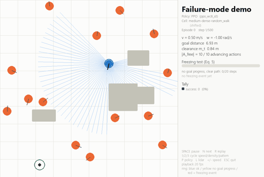
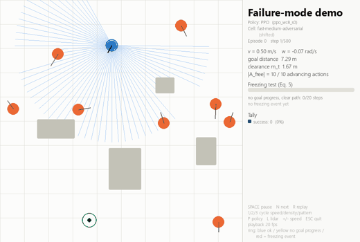
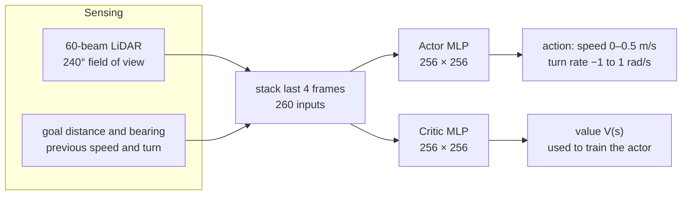
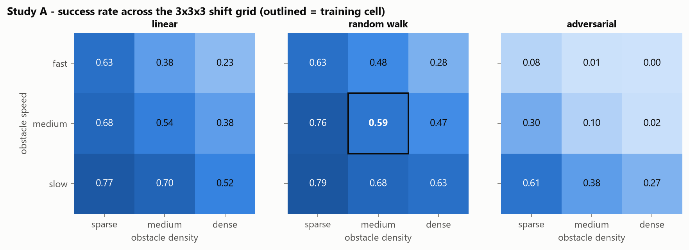
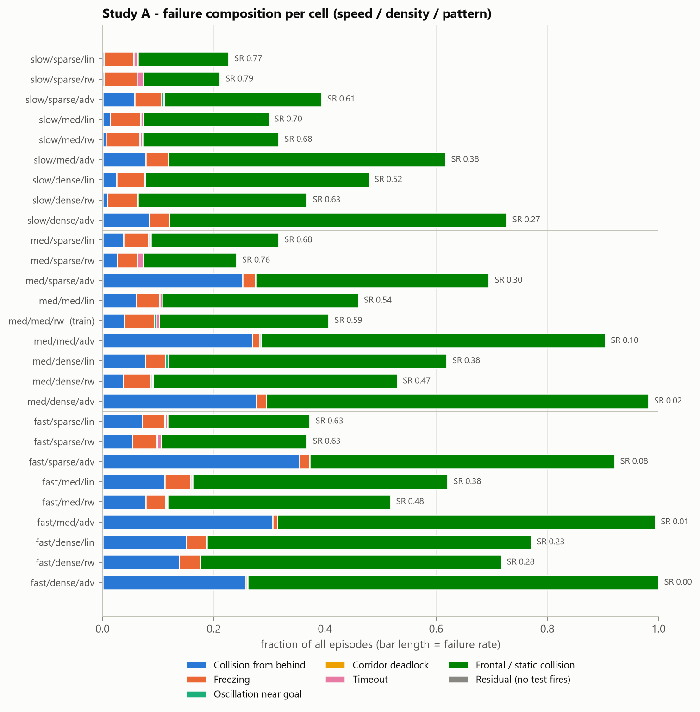
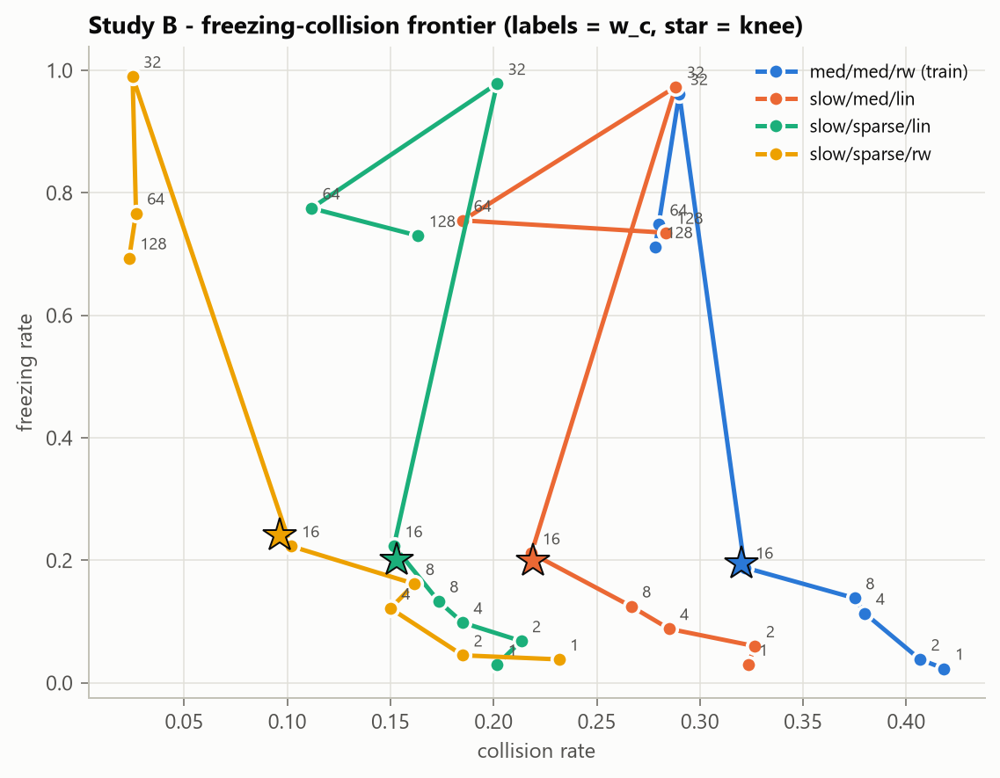

<div align="center">

# Failure-Mode Characterisation of PPO Navigation Under Environment Shift

**A success rate hides *how* a robot fails. This project measures the how.**


</div>

---

A PPO navigation policy is trained in **one** environment of a 3×3×3 shift grid (obstacle **speed** × **density** × **motion pattern**) and evaluated in all **27** environments. Every failed episode is labelled with **exactly one** cause, so we can see *which* mechanism breaks the policy, not just how often it breaks.

## Key results

| | Result |
|---|---|
| Success in the training environment | **59.3%** |
| Mean success across the other 26 environments | **≈ 44%** (generalisation gap **0.157**) |
| Episodes evaluated | **27,000** (5 seeds × 27 environments × 200 episodes) |
| Failures that are head-on or wall/block collisions | **73%** of all failures |
| Matched-success environment pairs that still fail differently | **16 of 30** (Holm-corrected χ², p < 0.05) |
| Safety-weight knee (where freezing and collisions trade off) | **w_c ≈ 16** (wide 95% CI, see below) |

**The headline:** environments that score the *same* success rate can fail for completely different reasons, so they need different fixes.

## Demo

<div align="center">

| Freezing: robot stops with a clear path | Collisions: fast, chasing obstacles |
|:---:|:---:|
|  |  |

</div>

Run it yourself with `python demo.py`. The side panel shows live speed, clearance, the number of collision-free advancing moves, a **freezing meter**, and the failure label at the end of each episode.

## Architecture

### The study pipeline

```mermaid
flowchart LR
    CFG["config.py<br/>every fixed constant"] --> TRAIN
    TRAIN["train.py<br/>PPO in the centre cell"] --> SA
    TRAIN --> SB
    TRAIN --> BASE
    SA["study_a.py<br/>27-cell evaluation"] --> SB
    SA --> AN
    SB["study_b.py<br/>safety-weight sweep"] --> AN
    BASE["baselines.py<br/>A*, fixed safety, adaptive risk"] --> AN
    METRICS["metrics.py<br/>freezing + failure taxonomy"] -. shared by all studies .-> SA
    METRICS -. .-> SB
    METRICS -. .-> BASE
    AN["analyze.py<br/>statistics, figures, summary"] --> OUT[("results/full/<br/>CSVs, figures, summary.md")]
    DEMO["demo.py<br/>live pygame visualiser"] -. reads models .-> TRAIN

    classDef core fill:#1f2937,stroke:#60a5fa,color:#f9fafb
    classDef out fill:#064e3b,stroke:#34d399,color:#ecfdf5
    class CFG,METRICS core
    class OUT out
```

### The agent



### The failure taxonomy

Labels are checked in a **fixed order**, and the first match wins. The thresholds were fixed before the full experiment.

| # | Label | What it means |
|:-:|---|---|
| 1 | `collision_from_behind` | Hit by an obstacle outside the 240° view, or from behind the lateral axis |
| 2 | `freezing` | Stopped while a collision-free advancing move existed |
| 3 | `oscillation_near_goal` | Close to the goal but keeps flipping its turn direction |
| 4 | `deadlock` | Boxed in on both sides with no clearance |
| 5 | `timeout` | Ran out of the 50 s budget |
| 6 | `frontal_static_collision` | Any other collision (head-on, wall, or static block) |

### Freezing, defined precisely

At every step the detector simulates **10 candidate moves** (2 speeds × 5 turn rates) one second ahead. A move is *free* if it is collision-free **and** reduces the goal distance. The robot is **freezing** when at least one free move exists but progress stays below δ = 5 mm per step for N = 20 steps. Stopping at a door with no safe move is **yielding**, not freezing.

## Results

<div align="center">

<br/><sub>Success over the 27 shift environments. The trained cell is outlined in the centre.</sub>
</div>

<br/>

<div align="center">

<br/><sub>Failure composition per environment. Two environments with the same success rate can have very different bars.</sub>
</div>

<br/>

<div align="center">

<br/><sub>Study B: freezing versus collision as the safety weight w_c changes. The knee is starred.</sub>
</div>

<details>
<summary><b>Caveat on the knee</b></summary>

The centre-cell knee is w_c* = 16.4, but its 95% bootstrap CI is [1.98, 128], so the exact tipping point is poorly pinned down. More seeds per weight would tighten it.

</details>

## Quick start

```bash
python -m venv .venv
.venv\Scripts\activate
pip install torch --index-url https://download.pytorch.org/whl/cpu
pip install -r requirements.txt
```

CPU is enough. The policies are small MLPs on a fast 2D simulator, so no CUDA is needed.

| Command | What it does | Time (20-thread laptop) |
|---|---|---|
| `python -m pytest -v tests` | Checks the freezing and taxonomy definitions | seconds |
| `python run_all.py --mode smoke` | Whole pipeline with tiny numbers, install check | ~1–2 min |
| `python run_all.py --mode quick` | 400k steps, 2 seeds, 4 safety weights, 30 eps/cell | ~15 min |
| `python run_all.py --mode full` | Full size: 2M steps, 5 seeds, 200 eps/cell | ~3.5 h (measured) |
| `python demo.py` | Live visualiser (`--cell fast medium adversarial`, `--policy astar`) | — |

Already-trained models are reused, so `Ctrl+C` and rerun to continue. Study B reads `study_a.csv`, so Study A must run first. Each stage is also available on its own (`train.py`, `study_a.py`, `study_b.py`, `baselines.py`, `analyze.py`).

> **Laptop memory.** Each parallel process loads PyTorch. If you see `WinError 1455`, lower the parallelism: `--jobs 2 --workers 3`.

The repo ships with the full run's CSVs, figures and the two demo models, so `python analyze.py --mode full` and `python demo.py` work without retraining.

**VSCode:** the Run and Debug panel (`Ctrl+Shift+D`) has ready-made configs for tests, each run mode and the demos.

## Project layout

```
navsim/
  config.py      every fixed constant: geometry, grid, reward, thresholds, run modes
  env.py         Gymnasium 2D simulator: unicycle robot, LiDAR, moving obstacles, reward
  metrics.py     freezing condition, six-test failure taxonomy, episode metrics
  policies.py    PPO wrapper and the A* baseline
  training.py    PPO training with Stable-Baselines3
  paths.py       one folder per run mode, so smoke/quick never overwrite full
train.py · study_a.py · study_b.py · baselines.py · analyze.py · run_all.py · demo.py
tests/test_metrics.py
results/full/    the full run: CSVs, summary.md, figures, two trained models
```

## Design decisions

Each of these is fixed in `config.py` before any experiment runs:

- **Reward:** w_g = 10 for the goal, w_p = 5 per metre of progress, w_t = 0.01 per step, crash weight w_c = 8 by default. The "fixed safety" baseline uses w_c = 32.
- **Training:** 2,048-step rollouts (256 steps × 8 envs), batch 256, learning rate 3e-4, γ = 0.99, PPO clip ε = 0.2, two 256-unit layers for both actor and critic.
- **A_free candidate set:** 10 moving actions, v ∈ {0.25, 0.5} m/s × ω ∈ {−1, −0.5, 0, 0.5, 1} rad/s. Stopping never counts as a clear action.
- **Taxonomy amendment:** a sixth category, `frontal_static_collision`, was added after a pilot run showed that 45 of 67 failures matched no original test. It was added before the full experiment and is checked last, so the original five counts do not change. The analysis reports the catch-all share (timeout + frontal/static) as the honest measure of how much the mechanism tests explain.

## Repository

Licensed under the [MIT License](LICENSE).
